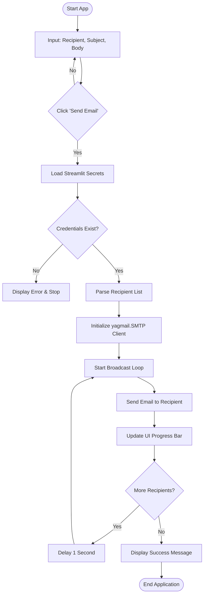

# Streamlit Email Mass Sender (Refactored with `yagmail`)

This Streamlit application allows you to securely send bulk or individual emails using **yagmail**, a highly intuitive wrapper around `smtplib`. It includes automated rate-limiting to prevent spam flags and incorporates a real-time progress bar interface.

## Features
- **Simplified Mail Handling**: Replaces complex `MIMEText` and connection logic with simple `yagmail.SMTP` handlers.
- **Dynamic Recipient Processing**: Converts comma-separated text input into a clean list of individual emails.
- **Secure Authentication**: Leverages Streamlit Secrets (`.streamlit/secrets.toml`) to prevent hardcoding sensitive Gmail credentials.
- **Visual Progress Tracking**: Real-time progress updates natively inside the Streamlit user interface.
- **Anti-Spam Safety**: Inserts an intentional delay between dispatches when handling multiple targets.

---

## 📂 Project Structure

Ensure your project directory structure matches the layout below before running the application:

```text
email-sender-app/
│
├── .streamlit/
│   └── secrets.toml   <-- Gmail credentials configured here
│
├── app.py             <-- Streamlit core application script
├── README.md          <-- Application documentation
└── requirements.txt   <-- Python dependency manifest
```

---

## ⚙️ Application Workflow



---

## 🔒 Configuration & Authentication

### 1. Requirements (`requirements.txt`)
Ensure you have the target libraries available inside your working environment:
```text
streamlit
yagmail
```

### 2. Google Account App Passwords
Gmail blocks standard password authentication from unverified third-party integrations. You must provision an **App Password**:
1. Head to your [Google Account Console](https://google.com).
2. Turn on **2-Step Verification** under the Security tab.
3. Search for or navigate to **App passwords**.
4. Generate a custom app name (e.g., `Streamlit Mailer App`) and click **Create**.
5. Save the generated 16-character string securely.

### 3. Streamlit Secrets Setup (`.streamlit/secrets.toml`)
Populate `.streamlit/secrets.toml` explicitly using this block structure:
```toml
[gmail]
username = "your_actual_email@gmail.com"
app_password = "abcd efgh ijkl mnop"  # The 16-character string without spaces
```

> ⚠️ **Security Warning:** Add `.streamlit/secrets.toml` directly into your `.gitignore` file immediately to avoid leaking credentials onto public version control systems.
